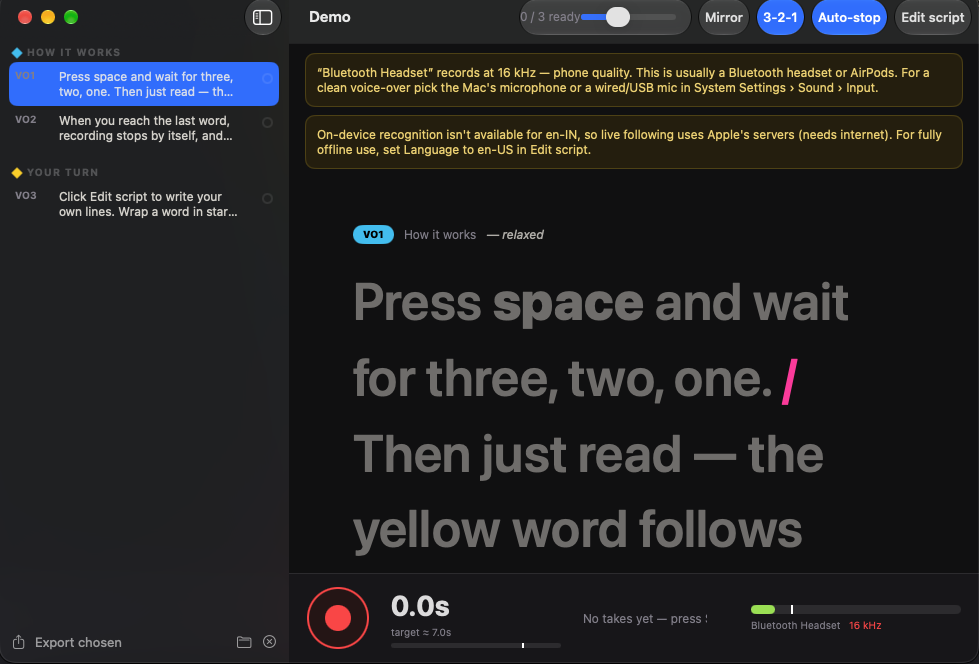

# Teleprompter

A teleprompter for Mac that **listens while you read**. The next word lights up as you speak, every take is recorded losslessly and checked word by word, and you keep the best take for each line — then export them all as one clean set of WAV files for your edit.



Made for voice-overs: reels, explainers, YouTube narration, course videos, podcasts.

## What it does

- **Follows your voice** — the word you're on is highlighted yellow, words you've read get a green underline. Uses Apple's speech recognition, on-device when your language supports it.
- **Records every take losslessly** — 24-bit WAV at your mic's native rate, including a short handle before and after (the 3-2-1 count-in is recorded, so nothing gets clipped).
- **Checks each take** — after you stop, the take is transcribed and lined up with your script: % of words read, which words were missed (shown in red), and your pace in words per minute. Pickups that only re-read the end of a line are recognised.
- **Auto-stop** — recording stops by itself once you've read the last word.
- **Script markup** — `*word*` for emphasis, a lone `/` for a breath, a direction note and a target length per line. The timer bar shows whether you're on pace.
- **Pick the best take** — play, compare, mark *Use*, delete. The sidebar shows which lines are done.
- **Export chosen takes** — one `VO1.wav`, `VO2.wav`… per line, ready to drop into Resolve, Premiere or Final Cut.
- **Mirror mode** for teleprompter glass, adjustable text size, keyboard-only workflow.
- **Mic quality warning** — tells you when you're recording through a 16 kHz Bluetooth headset (AirPods etc.) instead of a proper mic.

## Install

Download **Teleprompter.zip** from [Releases](../../releases), unzip, and move **Teleprompter.app** to Applications.

The app isn't notarised, so the first time: **right-click → Open → Open**. (Or run `xattr -dr com.apple.quarantine /Applications/Teleprompter.app`.)

Allow **Microphone** and **Speech Recognition** when asked. Requires macOS 14 or later; runs natively on Apple Silicon and Intel.

## How to use

1. **New project** — give it a name and paste your script (a blank line starts a new line to record, `# Heading` starts a section). Projects are saved in `Documents/Teleprompter/`.
2. Press **Space**, wait for 3-2-1, and read. The yellow word follows you.
3. When it stops, look at the take card: **100% words** means you got every word. Missed words turn red in the script.
4. Press **U** (or *Use*) on the take you like. Re-record with **R** as many times as you want.
5. **File → Export Chosen Takes…** writes one WAV per line.

| Key | Action |
| --- | --- |
| Space | Record / stop |
| ← → | Previous / next line |
| R | Retake |
| P | Play last take |
| U | Use last take |
| ⌘E | Edit script |
| ⌘+ / ⌘− | Text size |
| ⇧⌘M | Mirror |

## Tips for a clean voice-over

- Use the Mac's built-in mic or a USB/wired mic, not AirPods or Bluetooth headphones — Bluetooth drops to 16 kHz "phone" quality while the mic is in use.
- Record in a small, soft room (a wardrobe full of clothes works wonders).
- Keep a fist's distance from the mic; aim for the meter peaking in the green-to-yellow area, never at CLIP.
- If a line is long, record it in two halves — the take check recognises pickups.

## Project format

```
Documents/Teleprompter/My Reel/
  script.json            # title, language, sections → lines {id, text, note, target}
  takes/VO1/take_1.wav   # every take, 24-bit WAV
  takes/VO1/take_1.json  # its word check
  takes/VO1/chosen.txt   # the take you picked
```

Plain files, so other tools can read them (the original version of this app was a small web page; it uses the same layout).

## Build from source

```bash
git clone https://github.com/saikiran9185/teleprompter.git
cd teleprompter
./build.sh --install     # builds a universal app and copies it to /Applications
```

Needs Xcode command-line tools (Swift 5.9+). No dependencies.

## License

MIT
